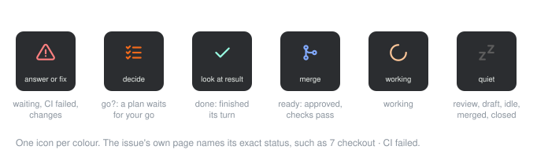

# Helm

Turns a Logitech MX Keypad into the helm of [herdr](https://herdr.dev): see which of your parallel coding agents need you, jump to them, and steer them with one key. The keypad and the screen always show the same issue.

An issue here is a herdr tab whose agent works on one branch, the way `hagent` opens them. The plugin reads herdr, not GitHub: it does not fetch GitHub issues.


## What it does

- **A status key** shows how many issues need you across every herdr workspace. Pressing it shows the most urgent issue in herdr and opens the folder on it; pressing it again walks on to the next. That the key opens the folder by itself is not yet confirmed on the keypad; if it does not, the folder key lands on that issue.
- **A folder** with three levels: your projects, the tabs of one project, and the actions for one issue.
- **Pull requests** show on the issue keys: failing checks, requested changes, ready to merge. helm reads them with the GitHub CLI.
- **Actions** such as go, review, babysit and commit go to that issue's agent. The one that fits lights up, and every press is confirmed on the key and in herdr.
- **The keypad follows the screen.** Switch tabs in herdr and the keypad's issue page moves along.

Every key says in one word how its issue is doing, in herdr's colours:



A plan counts when the agent's output has a line starting with `Single PR:` or `PR 1:`; change `planPattern` in the config to match your own format.

## Install

```bash
./install.sh
```

It builds the plugin and links it into Logi Options+, links the action config, and adds keypad chords to herdr. It is safe to run again; run it after every pull. Then, once, in Logi Options+: open **Installed Plugins > Herdr** and drag the **Herdr** folder and the **Herdr status** key onto keys of your keypad.

Needs macOS, Logi Options+ with Logi Plugin Service 6.4 or later, herdr, iTerm2 (configurable), and the GitHub CLI `gh`, logged in, for the pull requests. The script installs the .NET 10 SDK in `~/.dotnet` when it is missing. The editor action and the chords call helper scripts in `~/.local/bin` (`hagent`, `hcleanup`, `hproject`, `hopen`), and the lazygit chord needs `lazygit`; without them, those keys do nothing.

## Configure

The issue page's actions live in `config/keypad.json`, which the plugin reads again on every save:

```json
{ "label": "go", "type": "prompt", "value": "go", "color": "#f36a1b", "when": ["go?"] }
```

## More

- **[How it works](docs/flows.md)**: every flow, with diagrams.
- **[Setup details](docs/setup.md)**: all config fields, the herdr chords, developing the plugin and uninstalling it.
