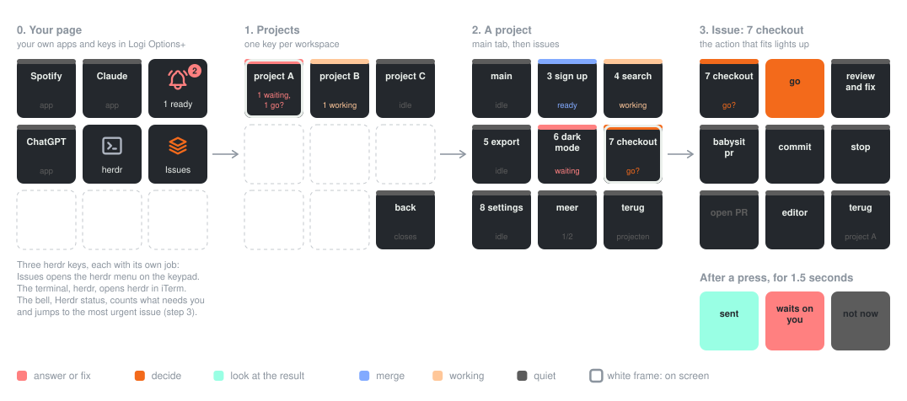

# Helm

The setup for my Logitech MX Keypad as the helm of [herdr](https://herdr.dev): a key per project, a key per ticket tab in it, and the actions for the ticket you pick. The keypad and the screen always show the same ticket.



It holds three things:

- **`plugin/`**: a Logi Actions plugin (C#, .NET 10) with a dynamic folder, **Herdr**, and a key, **Herdr status**.
- **`config/keypad.json`**: the actions on a ticket's page.
- **`herdr/keys.toml`**: direct `ctrl+alt+shift` chords for the ticketflow scripts, so a plain keystroke key can run them.

## Install

```bash
./install.sh
```

It installs the .NET 10 SDK in `~/.dotnet` when missing (no sudo), builds the plugin and links it into the Logi Plugin Service, links `~/.config/herdr-keypad/config.json` to `config/keypad.json`, and writes `herdr/keys.toml` into herdr's `config.toml` between `helm: keypad chords` markers. It is safe to run again; run it after every pull.

Then, once, in Logi Options+: select the keypad, open **Installed Plugins > Herdr**, drag the **Herdr** folder onto a key, and drag **Herdr status** onto another key of your normal page.

Needs Logi Options+ with Logi Plugin Service 6.4 or later, herdr, and the herdr-ticketflow scripts in `~/.local/bin` for the chords and the editor action.

## How it works

Diagrams of every flow, from navigation to what the plugin does on its own, are in [docs/flows.md](docs/flows.md).

**One rule: the keypad and the screen show the same ticket.** Pressing a tab on the keypad shows it in herdr; switching tabs in herdr moves the keypad's ticket page along. An action always goes to the ticket you are looking at.

Every key shows its agent's status in the quarterdeck's words and herdr's colours:

| Colour | Status |
|---|---|
| red | `waiting`: the agent asks you something |
| orange | `go?`: a plan waits for your go; `done`: the agent finished |
| yellow | `working` |
| grey | `idle` |

A white frame marks the project and the tab that are on screen.

**The status key.** On your normal page: what needs you across every project, such as "1 waiting, 1 go?". Pressing it shows the most urgent ticket in herdr and opens the folder on it.

**Projects.** One key per herdr workspace, in herdr's order, with up to two counts and the colour of its most urgent status. Pressing one shows that workspace in herdr and opens its page.

**A project.** Its main tab first (the Claude in the main checkout, shown as "main"), then its ticket tabs in the order you opened them. A ticket tab is a tab named after a branch, or one whose agent runs in a worktree, which is what `hagent` makes. Each key shows the branch without its `feat/` prefix and without the leading words most tickets share. Pressing one shows that tab, in iTerm, and opens its page.

**A ticket.**

| | | |
|---|---|---|
| the ticket | go | toestaan |
| review and fix | code review | commit |
| stop | editor | terug |

The action that fits the ticket's status lights up: `go` for `go?`, `toestaan` for `waiting`, `review and fix` for `done`. One that does nothing is greyed out: `toestaan` works only while the agent waits on you. After a press the key flashes `sent` or the reason it was not sent, and herdr shows a notification. Every action goes to that ticket's agent through the herdr CLI, never to whatever pane happens to have focus.

**terug** goes up one level. On the projects page, the back key the service adds closes the folder. When a level has more items than fit beside the way back, seven share a page with **meer**, which pages through the rest. The plugin reads herdr every two seconds; a closed tab or workspace drops you one level up on its own.

## Changing the actions

Edit `config/keypad.json`. The plugin reads it again when it changes, so no rebuild is needed.

| Field | Meaning |
|---|---|
| `type: "prompt"` | `value` plus Enter, to the ticket's agent (`herdr agent prompt`) |
| `type: "keys"` | key presses for the ticket's agent, space separated: `enter`, `esc`, `ctrl+c` |
| `type: "shell"` | a command run in the ticket's worktree, with `$TICKET_CWD` set |
| `color` | the stripe on the key, `#RRGGBB` |
| `when` | the ticket statuses in which the key lights up, such as `["go?"]` |
| `onlyWhen` | the statuses in which the key works at all; it is greyed out in the others |
| `terminalBundleId` | the app brought to the front when you pick a ticket (iTerm2 by default); `""` leaves focus alone |
| `openHerdrWhenClosed` | with no herdr window open, picking a ticket opens a new iTerm window and starts herdr in it, on that ticket (iTerm only; `true` by default). macOS asks once whether the Logi Plugin Service may control iTerm |

## Chords

`herdr/keys.toml` adds these direct chords, for keystroke keys in Options+:

| Chord | Action |
|---|---|
| `ctrl+alt+shift+g` | new ticket tab (`hagent`) |
| `ctrl+alt+shift+k` | clean up the ticket tab (`hcleanup`) |
| `ctrl+alt+shift+s` | pick a project workspace (`hproject`) |
| `ctrl+alt+shift+e` | open the tab's checkout in the editor (`hopen`) |
| `ctrl+alt+shift+l` | lazygit in the tab's folder |

herdr's built-in actions get their chords in the `[keys]` table of `config.toml`, which a block at the end of the file cannot extend, so they stay there by hand:

```toml
next_agent = ["prefix+a", "ctrl+alt+shift+n"]
previous_agent = ["prefix+shift+a", "ctrl+alt+shift+p"]
open_notification_target = ["prefix+o", "ctrl+alt+shift+o"]
workspace_picker = ["prefix+w", "ctrl+alt+shift+w"]
focus_agent = "ctrl+alt+shift+1..9"
```

## Developing

```bash
cd plugin/src
DOTNET_ROOT="$HOME/.dotnet" PATH="$HOME/.dotnet:$PATH" dotnet watch build
```

Each build relinks the plugin and asks the Logi Plugin Service to reload it. The plugin logs to `~/Library/Application Support/Logi/LogiPluginService/Logs/plugin_logs/Herdr.log`. After moving the repo, the service may refuse the new path with "plugin 'Herdr' is already loaded": use **Restart Logi Plugin Service** in the Options+ settings.

## Uninstall

```bash
rm ~/Library/Application\ Support/Logi/LogiPluginService/Plugins/HerdrPlugin.link ~/.config/herdr-keypad/config.json
```

Then remove the `helm: keypad chords` block from herdr's `config.toml` and restart the Logi Plugin Service.
