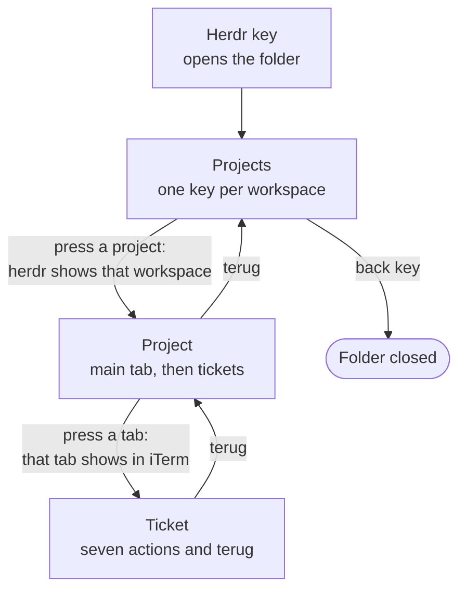
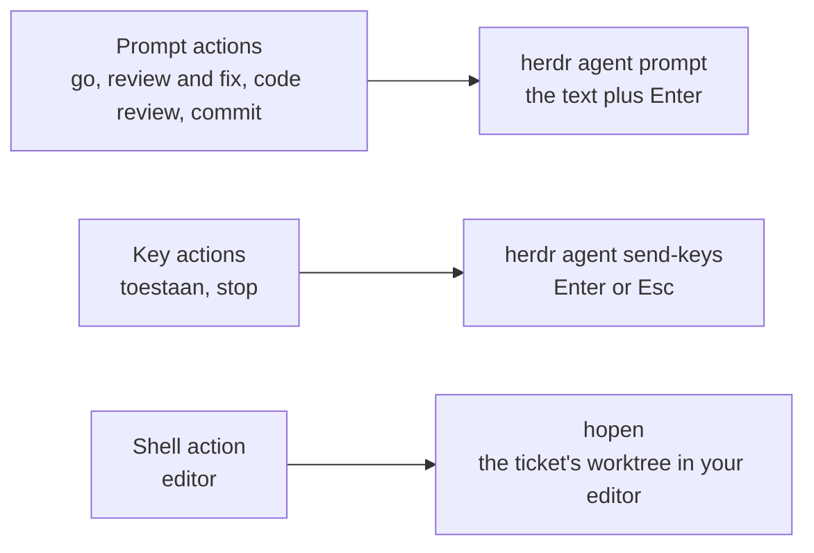
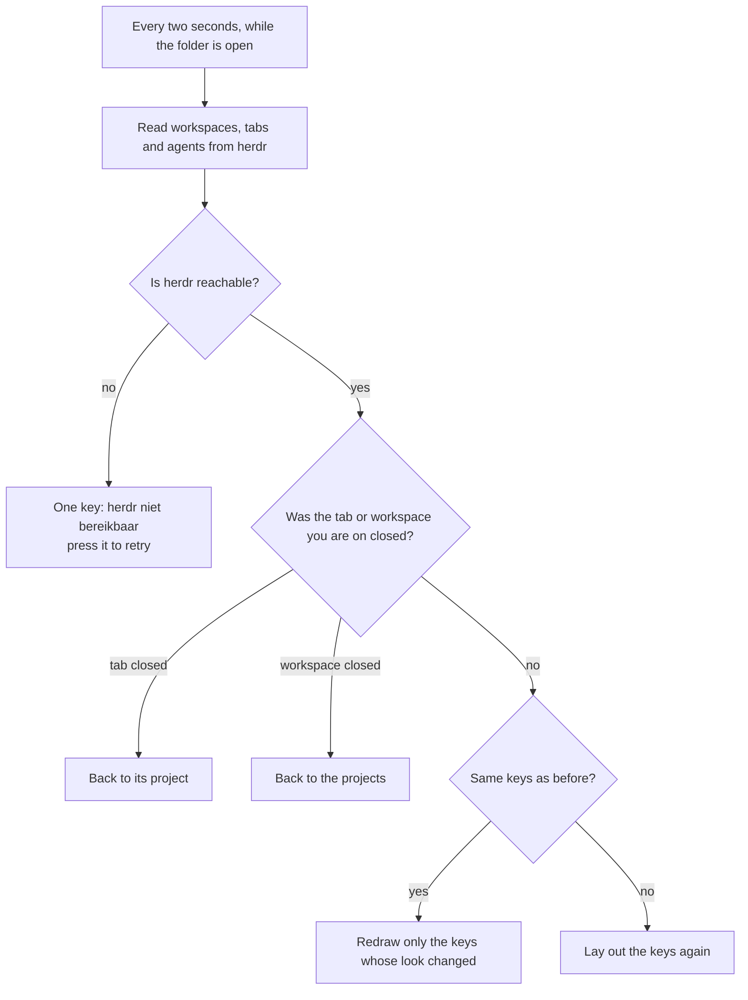

# Keypad flows

How the **Herdr** folder on the keypad moves between pages, what each action runs, and what the plugin does on its own. The keys themselves carry Dutch labels (`terug`, `toestaan`, `meer`); this page uses them as they appear on the keypad.

## Navigation

The folder has three levels. Pressing a key goes one level down; `terug` goes one level up. On the projects page, the back key the Logi Plugin Service adds closes the folder.

Every key has a stripe in a status colour. A project's stripe is the most urgent status among its agents.

| Stripe | Status |
|---|---|
| red | the agent waits on you (`blocked`) |
| orange | done |
| yellow | working |
| grey | idle |

## Picking a tab

The keys switch to the ticket page at once; focusing the tab runs in the background.

A herdr window is any `herdr` process that attaches to the server. The server itself, `herdr server`, keeps running after iTerm closes, so statuses and actions work without a window; only showing the tab needs one.

## Actions on a ticket

Each action goes to the agent of the ticket you picked on the keypad, never to whatever pane has focus. After an action, the ticket page stays open for the next one.

| Key | What it does |
|---|---|
| the ticket | focuses its tab again |
| `go` | sends `go`: approves the plan the agent shows |
| `toestaan` | presses Enter: picks the selected option of a permission prompt, usually Yes |
| `review and fix` | runs `/review-and-fix` |
| `code review` | runs `/code-review` |
| `commit` | asks for the work in logical conventional commits |
| `stop` | presses Esc: interrupts the agent |
| `editor` | opens the ticket's worktree with `hopen` |
| `terug` | back to the project |

The actions come from `config/keypad.json`; see the README to change them.

## What happens on its own

While the folder is open, the plugin reads herdr every two seconds and redraws only what changed.

Two more behaviours:

- **More items than keys.** A page has nine keys. When a level has more items than fit beside the way back, seven share a page with `meer`, which pages through the rest.
- **The folder closes on an app switch.** The Logi Plugin Service may close the folder when iTerm comes to the front. The plugin keeps its place, so pressing the Herdr key again opens the page you were on.
