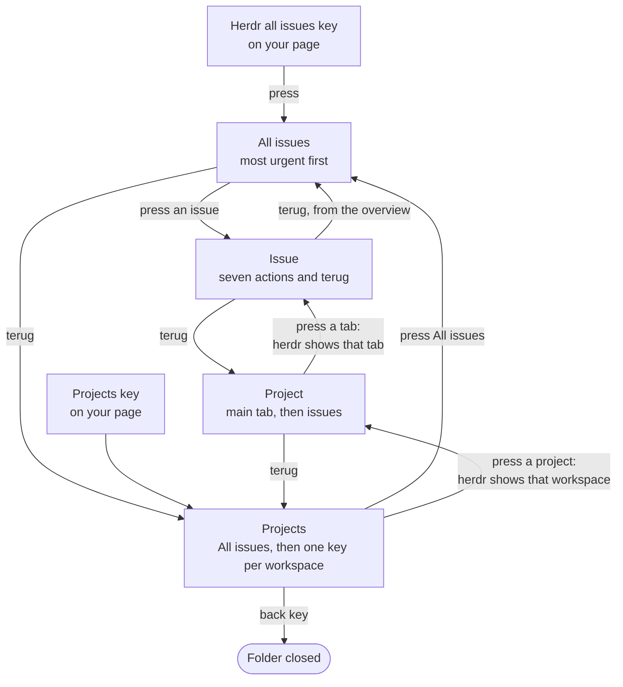
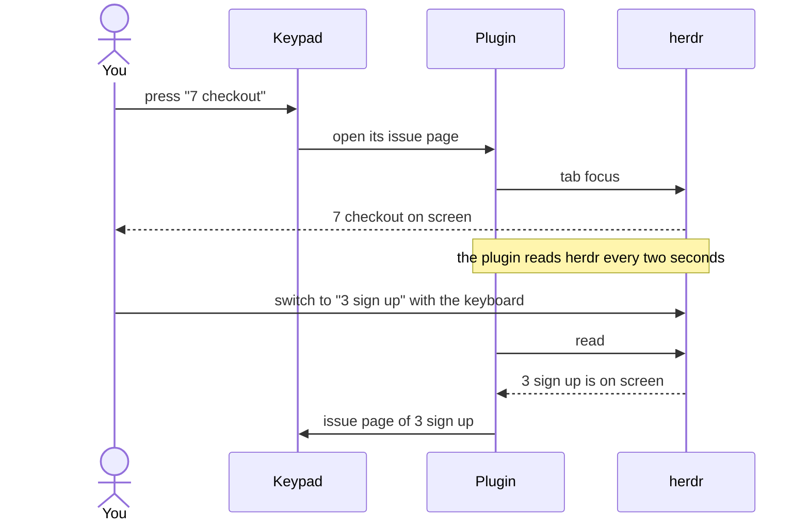
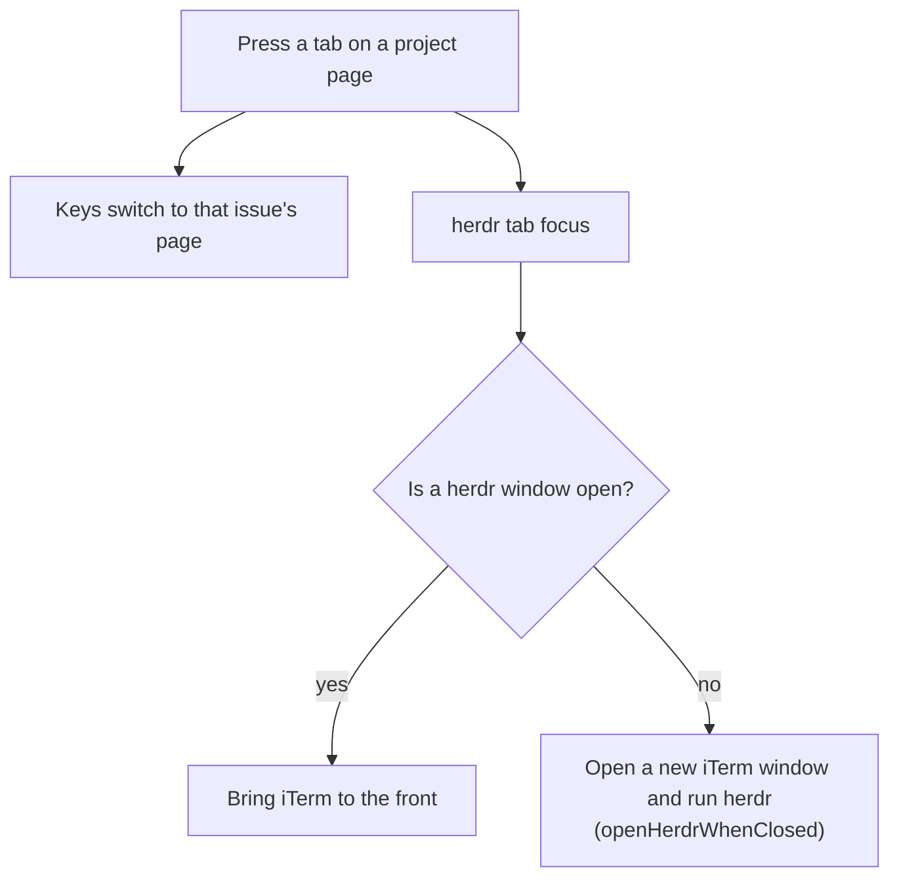
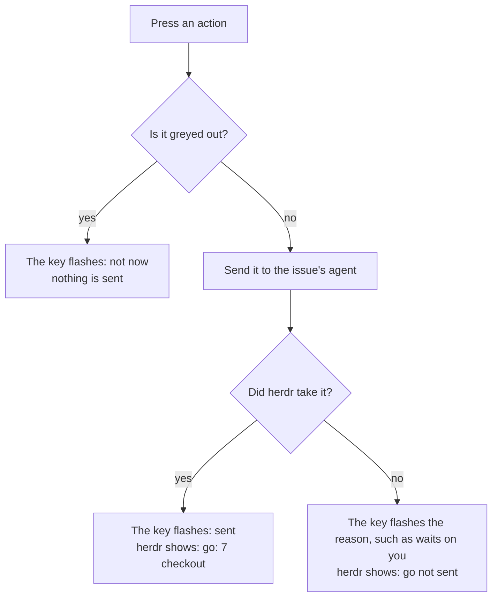
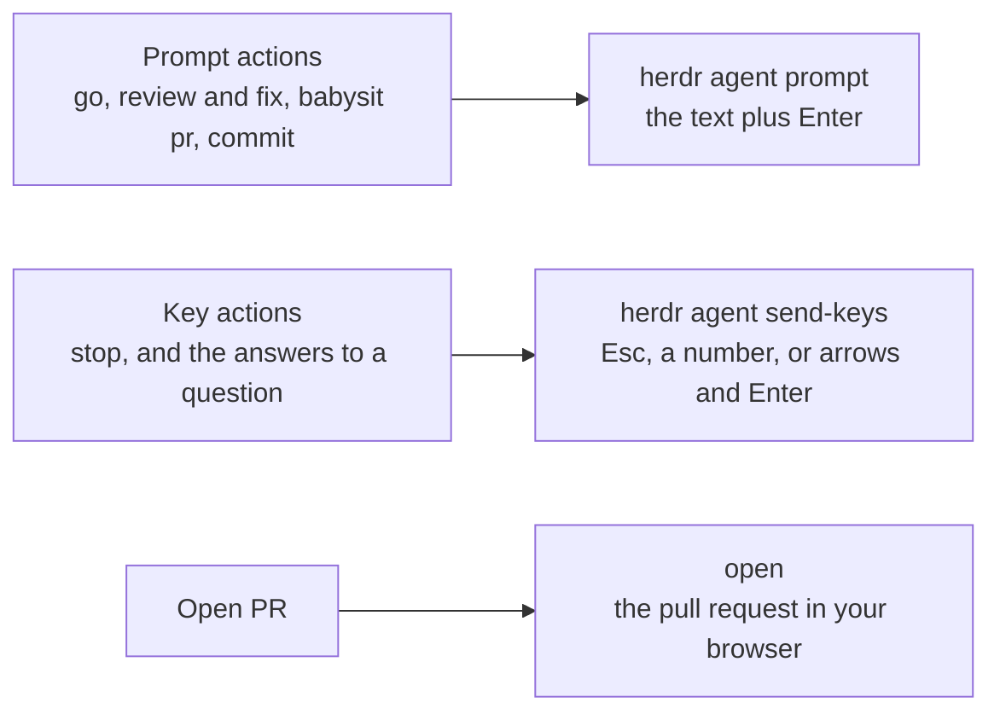
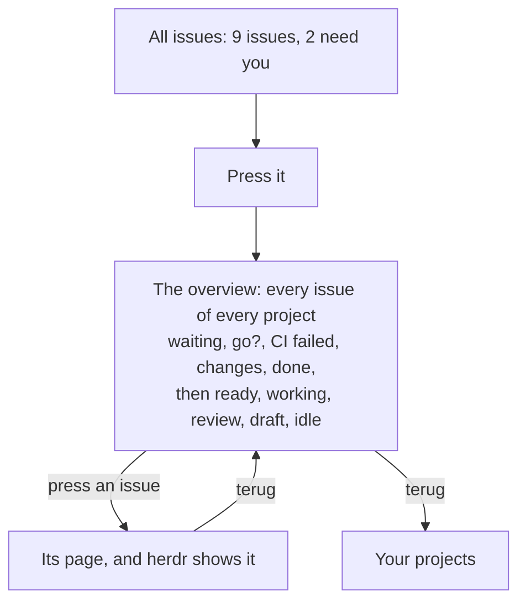
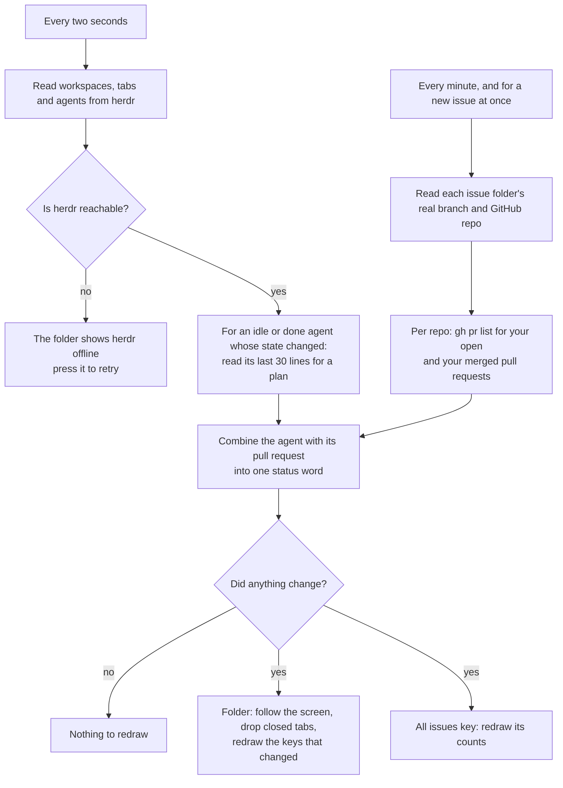

# Keypad flows

How the keypad works with herdr: the pages, what each key does, and what the plugin does on its own. The keys carry Dutch labels for navigation (`terug`, `meer`); this page uses them as they appear on the keypad.

## Your page

The keypad starts on a page you set up yourself in Logi Options+, with your own apps and keys. helm adds three keys to it, each with its own job:

| Key | On the key | What it does | Where |
|---|---|---|---|
| Herdr projects | an orange stack, Projects | opens the herdr menu below, always on your projects | on the keypad |
| Herdr all issues | a list, with how many need you in a badge in the colour of the most urgent | opens an overview of every issue, most urgent first | on the keypad |
| Open herdr | a grey terminal, herdr, like an app key | opens herdr itself in iTerm: in front if it runs, else in a new iTerm window | on the screen |

## One rule: the keypad and the screen show the same issue

Whatever you do on one, the other follows. Pressing a tab on the keypad shows it in herdr. Switching tabs in herdr, with the keyboard or the mouse, moves the keypad's issue page along. So an action always goes to the issue you are looking at.

You still reach every project and every issue from the keypad; the rule only concerns the issue whose page is open.

## Statuses

Every key shows an icon and a word for its issue, from its agent and its pull request, in herdr's colours. The agent wins while it asks or works; after that the pull request speaks.

| Colour | Status | Meaning |
|---|---|---|
| red | `waiting` | the agent asks you something: a permission or a question |
| orange | `go?` | the agent sits still with a plan waiting for your go, and there is no pull request yet |
| red | `CI failed` | the pull request's checks fail |
| red | `changes` | a reviewer asked for changes |
| green | `done` | the agent finished its turn: look at the result |
| blue | `ready` | the pull request is approved and its checks pass: yours to merge |
| yellow | `working` | the agent is busy |
| grey | `review`, `draft` | the pull request waits on a review, or is a draft |
| dark grey | `idle`, `merged`, `closed` | nothing going on, or nothing left to do |

A plan is a line in the agent's last output that matches `planPattern` in `config/keypad.json`; by default a line starting with `Single PR:` or `PR 1:`.

A project key shows the most urgent status among its tabs, with up to two counts, such as "1 waiting, 1 go?". A white ring marks the project and the tab that are on screen.

## Navigation

When a level has more items than fit beside the way back, seven share a page with `meer`, which pages through the rest.

## The keypad and the screen together

- **On an issue page** the keypad follows the tab herdr shows, across projects too.
- **On the projects, project and overview pages** it does not jump, because you are browsing there; it marks what is on screen with a white ring instead.
- **The Projects key always opens on your projects,** wherever you were before. Only the All issues key opens it elsewhere: on the overview.
- **`terug` always goes one level up:** from an issue to the overview or the project you came from, and from there to your projects. Only the projects page closes the menu, with Logi's back key.
- **Only a change on the screen counts.** Right after a key press herdr may still show the previous tab for a moment; the keypad does not jump back to it.

## Picking a tab

The herdr server keeps running after iTerm closes, so statuses and actions work without a window; only showing the tab needs one.

## The issue page

The page shows the issue with its status, and its pull request number when it has one, seven actions and `terug`. The action that fits the issue's status lights up as a filled circle in its colour; an action that does nothing in that status is greyed out.

| Issue status | Lights up | Greyed out |
|---|---|---|
| `go?` | `go` | `open PR` without a pull request |
| `CI failed`, `changes` | `babysit pr` | |
| `done` | `review and fix` | |
| `ready` | `open PR` | |
| `waiting` | the page shows the agent's question instead, see below | |

| Key | What it does |
|---|---|
| the issue | shows its tab again |
| `go` | sends `go`: approves the plan the agent shows |
| `review and fix` | runs `/review-and-fix` |
| `babysit pr` | runs `/babysit-pr`: drives the pull request through its checks and review |
| `commit` | asks for the work in logical conventional commits |
| `stop` | presses Esc: interrupts the agent |
| `open PR` | opens the issue's pull request in your browser |
| `editor` | opens the issue's worktree with `hopen` |
| `terug` | back to the project, or to the overview when you came from there |

The actions, and when they light up or grey out, come from `config/keypad.json`; see [Setup details](setup.md) to change them.

## Answering a question

While an agent waits on you, its page shows the question it asks, such as Claude Code's permission prompt, with one key per choice exactly as the screen lists them.

- **Each key sends its own choice.** A numbered choice is picked by the number the screen shows, which is not always its position: in Claude Code 2.1, `No` is choice 4, after `Yes, and switch to auto mode`. Choices without numbers, such as the folder-trust question, are reached with the arrow keys from the selected one, then Enter.
- **Nothing is sent blind.** Just before sending, helm reads the question again; when the choices changed, it sends nothing and the key reads `changed`.
- **A question helm cannot read** shows only `answer on screen`, which brings the issue's tab to the front so you answer it there.
- **Every choice names its issue.** Each choice key carries the issue's name under it, the top-left key shows the issue and what it asks about, and the screen shows that same issue.
- **Yes in green, No in red,** anything else neutral, so the answer reads at a glance.

## Pressing an action

Each action goes to the agent of the issue on the page, by its pane, never to whatever pane has focus. The page stays open for the next action.

## All issues

A key for your normal keypad page, outside the folder, and the first key on the projects page. It reads how many issues you have across every project, such as "9 issues", with how many need you in a badge, in the colour of the most urgent one. Main tabs are not issues, so they do not count. Pressing it opens the menu on one overview of every issue, most urgent first, so you can look at each of them in detail.

Within a status, issues keep the order of their projects and tabs. Main tabs come last, unless they need you. A main tab, or an issue shown beside other projects' issues, names its project, such as "main · project B". `ready` does not count as needing you; it sorts right after the issues that do.

The key opens the folder through a generic action of the Logi plugin API that is not documented for folders. If the menu does not open, the Projects key takes you to every issue through its project.

## What happens on its own

One reader serves the whole plugin, so the folder and the All issues key always agree. It reads herdr every two seconds and pull requests once a minute.

- **Pull requests come from the GitHub CLI.** Per repo, helm asks for your own open pull requests with their checks and review decision, and your own merged ones; two calls a minute, whatever the number of issues. It matches them to an issue by the branch the issue's worktree is on, not by the tab's label, which can be stale. Without `gh`, or for a repo that is not on GitHub, issues simply have no pull request.
- **A failed call keeps what helm knew,** so one GitHub hiccup does not blank the keys.
- **A closed tab** drops the folder back to its project; a closed workspace back to the projects.
- **The folder may close on an app switch.** The Logi Plugin Service can close it when iTerm comes to the front. Pressing the Projects key opens it again, on your projects.

